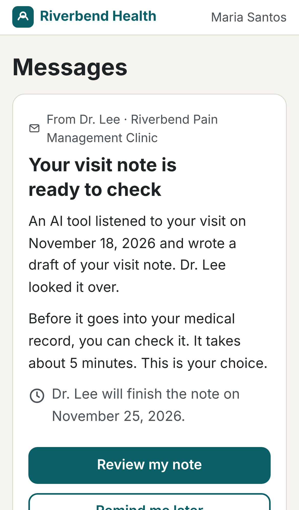
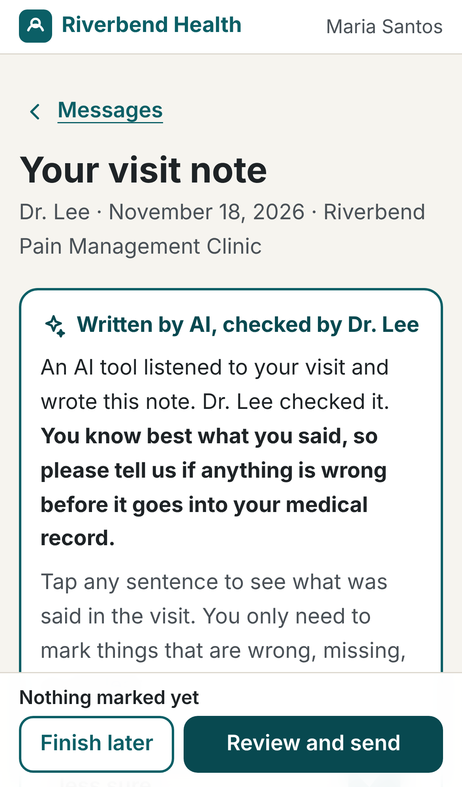
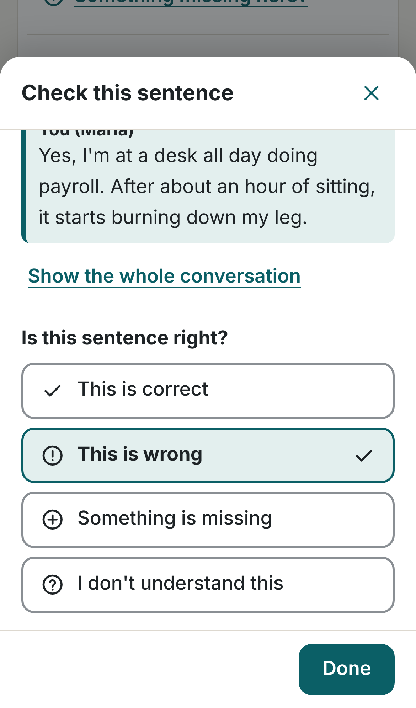

# Check your visit note: patient review of AI-drafted notes

**[Try the prototype ↗](https://hebamoussa.com/note-review/)** · **[Research direction ↗](https://hebamoussa.com/research)** · **[Portfolio](https://hebamoussa.com)**

<p>
  
  
  
</p>

     

A clickable research prototype for one question: **how can patients review and correct an AI-drafted clinical visit note (from an ambient AI scribe) before it enters the medical record, without adding burden?**

A fictional patient, Maria Santos (52, chronic low back pain), gets her AI-drafted visit note in a patient portal. She can see where each sentence came from in the visit conversation, mark sentences as correct, wrong, missing something, or unclear, review her answers and send them. A clinician view shows how Dr. Lee would receive the corrections. A hidden study mode supports moderated usability testing.

> **Fictional data only.** Every person, clinic, date and health detail is invented. There is no backend, no AI API and no analytics. Answers and study logs stay in the browser's `localStorage` until you export them.

## Screens

| Route | Screen |
|---|---|
| `#/` | Portal message: **Review my note** / **Remind me later** / **Skip**, all the same size |
| `#/review` | The note. An AI label at the top, tappable sentences, "AI was less sure" markers, "Something missing here?" per section, and a sticky footer with **Finish later** and **Review and send** |
| `#/summary` | Every answer in one list (change or remove), an optional message, then **Send** |
| `#/sent`, `#/later`, `#/skipped` | Confirmation and "come back later" screens |
| `#/clinician` | Clinician view: original sentence, patient's correction, transcript excerpt, and **Accept / Edit / Decline** (Decline requires a reason), plus an updated-note preview |

**Flagging takes two taps.** Tap a sentence, then tap an answer, and it's saved. "This is correct" saves and closes. "Wrong" and "missing" then offer optional quick reasons and a text box.

## Run it locally

Requires Node 18 or newer.

```bash
git clone https://github.com/hmyes2021/patient-note-review.git
cd patient-note-review
npm install
npm run dev
```

Open the address it prints (default http://localhost:5175/).

Other scripts:

```bash
npm test             # unit tests: content checks, scoring, CSV
npm run build        # type-check and build static files into dist/
npm run preview      # serve dist/ at http://localhost:4174/
npm run test:flow    # end-to-end study-mode run (needs `npm run preview` running)
npm run test:a11y    # axe + 320px reflow + 200% text + 44px targets + keyboard (needs preview running)
```

The two browser scripts use Playwright. If it isn't installed: `npm i -D playwright && npx playwright install chromium`.

## Live version

The prototype runs at **[hebamoussa.com/note-review](https://hebamoussa.com/note-review/)**. The study link is **hebamoussa.com/note-review?study=1**.

## Deploy your own copy

The build is plain static files with relative paths and hash routes, so it needs no redirects or server settings.

**Netlify.** Use "Add new site → Import from Git", choose this repo. `netlify.toml` already sets the build command (`npm run build`) and publish folder (`dist`). Alternatively, run `npm run build` and drag `dist/` onto app.netlify.com/drop.

**Vercel.** Use "Add New → Project", import the repo. Vercel detects Vite (build `npm run build`, output `dist`).

**Any static host.** Upload the contents of `dist/`. It also works from a sub-folder (for example `yoursite.com/note-review/`).

## Edit the scenario (no code changes)

Everything lives in `src/content/`. Edit, save, and the dev server reloads. If ids don't line up, the app shows a plain list of what to fix instead of the prototype, and `npm test` fails with the same list.

| File | What it holds |
|---|---|
| `scenario.json` | Portal and clinic names, patient, clinician, visit date, review deadline, minutes estimate |
| `transcript.json` | The visit conversation: `{ "id": "t14", "speaker": "patient" \| "clinician", "text": "…" }` |
| `note.json` | Sections and sentences. Each sentence has `sourceTurns` (transcript ids for "Where did this come from?"), `sourceMatch` (`"direct"`, or `"closest"` when the scribe found no exact source) and `confidence` (`"high"`, or `"low"` to show the "AI was less sure" marker) |
| `answer-key.json` | Researcher only. The seeded errors (`target.sentenceId`, or `target.sectionId` for omissions), which answers count as found (`foundWhen`), omission `keywords`, and the "less sure but correct" sentences |
| `ui-text.json` | All wording: buttons, quick reasons, decline reasons, help text. `{clinician}`, `{visitDate}`, `{deadline}`, `{minutes}` and `{count}` are filled in automatically |

### Seeded errors

The default scenario plants a small set of errors (omissions, hallucinations, misattributions, wrong doses and wrong details) in the note, and marks some correct sentences "AI was less sure" so you can measure over-reliance on the marker. They are listed in `answer-key.json`, which is for researchers only. They aren't described here so that participants who find this repository don't see the answers.

**Scoring.** A sentence error counts as **found** if the participant marks that sentence "wrong" or "missing", and as **noticed** if they mark it "I don't understand". The omission counts as found if they add a "missing" note to that section or a sentence in it, or a "missing" note anywhere whose text contains a keyword.

## Study mode

Open the app with `?study=1` before the `#`, for example `https://your-site.netlify.app/?study=1#/`. A dashed **Researcher** button appears in the header and shows the running timer.

In the researcher panel:
1. **Participant ID** and **Condition**: *Confidence markers ON* or *OFF*. In study mode the patient's "Show where the AI was less sure" switch is hidden, so the condition is fixed. Tick "Let the participant use the switch" to test the switch itself.
2. **Start task** clears answers, starts the timer and opens the message screen. The timer stops automatically when the participant sends, skips or picks "Remind me later". **Stop task** stops it by hand.
3. **Results** shows each seeded error as found, noticed or missed, plus false alarms (correct sentences marked wrong), with the "less sure but correct" ones listed separately, and the number of sentences opened.
4. **Export (CSV)**:
   - *Event log*: one row per action. Columns: time, ms since start, participant, condition, event, target, flag, reason, text, detail. Events: `task_started`, `screen_viewed`, `review_started`, `sentence_opened`, `section_missing_opened`, `full_transcript_toggled`, `flag_set`, `reason_set`, `text_entered`, `flag_removed`, `summary_viewed`, `message_entered`, `sent`, `remind_later`, `review_skipped`, `confidence_switch`, `condition_set`, `clinician_decision`, `clinician_signed`, `task_ended`.
   - *Session summary*: one row with time on task, counts, each error's result and answer, false alarms and message length.
   - *Final answers*: one row per sentence with the AI confidence, the seeded error (if any) and the participant's answer.
5. **Reset session** clears everything for the next participant. Export first.

**Suggested session.** Set the participant ID and condition, then Start task and close the panel. Hand over the phone with the scenario: "You had a visit with Dr. Lee last week. Here's the message you got." Afterwards, export all three CSVs, then Reset.

Data stays in that browser only. Use one device per session and export before you clear the browser. Typed text is logged as written, so remind participants not to type real personal information. CSV cells that start with `=`, `+`, `-` or `@` get a leading apostrophe so spreadsheets don't run them as formulas.

## Accessibility

The target is WCAG 2.2 AA. `npm run test:a11y` runs axe-core (WCAG 2.0/2.1/2.2 A and AA plus best-practice rules) on every screen, dialog and clinician state at 390px, at 320px, at desktop width, and at 390px with text at 200%. It also checks for horizontal scrolling, controls smaller than 44×44px, and keyboard focus (focus moves into the sheet, Tab stays inside it, Escape returns focus to the sentence).

Built in:
- 18px body text, all sizes in rem
- one accent colour (#0B5F66, 7.3:1 on white)
- confidence and answer states shown with text and icons, not colour alone
- visible 3px focus rings
- native modal `<dialog>`
- focus moves to the page heading on each screen change
- polite live-region announcements ("Saved: This is wrong")
- a sticky footer that never hides the focused item
- reduced-motion support

Patient-facing text scores about grade 3–4 on Flesch-Kincaid.

## Code map

```
src/content/        scenario JSON (edit these)
src/lib/            content loader and checks, types, scoring, CSV
src/state/          store (React context + localStorage), hash router
src/screens/        Welcome, Review, Summary, Sent, DoneForNow, ClinicianView
src/components/     NoteSentence, FlagSheet, Sheet (dialog), Transcript, StudyPanel, Layout, LiveRegion
e2e/                flow.mjs (study run), a11y.mjs (accessibility)
```

Stack: React 18, Vite, TypeScript, Tailwind CSS v4, Vitest.
